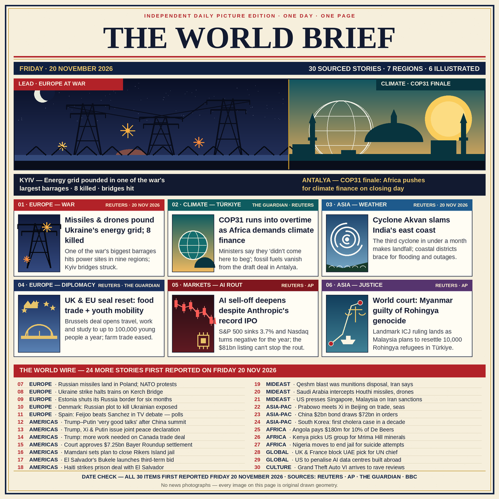

# The World Brief — Friday 20 November 2026: 30 sourced stories, 7 regions, 6 illustrated

An original editorial magazine-cover poster for [make.fun](https://make.fun/bounty/news-image-20261120): one day of world news — Friday, 20 November 2026 — summed up in a single 1024 × 1024 image. Six lead stories are illustrated with drawn geometry; a World Wire column adds 24 more dated stories. The poster contains no news photography; every illustration is original vector-style geometry drawn by `render.py` (Pillow, deterministic, supersampled 2048 → 1024).

## The six illustrated stories

1. **Ukraine.** Russian missile and drone attacks struck energy facilities and killed eight people. [Reuters](https://www.reuters.com/world/europe/fire-broke-out-ukraines-kyiv-after-missile-strike-mayor-says-2026-11-20/)
2. **COP31, Türkiye.** African ministers pressed for climate finance as talks in Antalya ran into overtime on their scheduled last day; the draft deal dropped fossil-fuel references. [The Guardian](https://www.theguardian.com/environment/2026/nov/20/cop31-talks-overtime-fossil-fuels-vanish-from-draft-deal) · [Reuters](https://www.reuters.com/sustainability/climate-focus-cop31-draft-deal-strips-fossil-fuel-references-2026-11-20/)
3. **India.** Cyclone Akvan made landfall on the east coast, the third cyclone to hit the country in less than a month. [Reuters](https://www.reuters.com/business/environment/indias-eastern-coast-hit-by-third-cyclone-within-month-2026-11-20/)
4. **United Kingdom & European Union.** The two sides agreed deals on food trade and youth mobility. [Reuters](https://www.reuters.com/world/uk/britain-eu-set-agree-reset-but-divisions-persist-2026-11-20/)
5. **Global markets & AI.** World stocks fell — the S&P 500 sank 3.7% — as Anthropic's record listing failed to reverse the selloff in AI stocks. [Reuters](https://www.reuters.com/world/china/global-markets-global-markets-2026-11-20/) · AP News Summary, 20 Nov 2026.
6. **Rohingya.** The UN's top court held Myanmar responsible for genocide against the Rohingya, as Malaysia announced a plan to resettle 10,000 Rohingya refugees in Türkiye. [Reuters](https://www.reuters.com/world/asia-pacific/malaysia-says-it-will-resettle-10000-rohingya-refugees-turkey-2026-11-20/) · AP, 20 Nov 2026.

## The World Wire (24 more, all first reported 20 Nov 2026)

Russian missiles land in Poland (AP) · Ukraine strike halts Kerch Bridge rail (AP) · Estonia closes Russia border (Reuters digest) · Denmark accuses Russian intelligence of a murder plot (AP) · Spain's Feijóo wins TV debate, polls say ([Reuters](https://www.reuters.com/business/media-telecom/spanish-pm-sanchezs-conservative-rival-wins-tv-face-off-polls-show-2026-11-20/)) · Trump–Putin "very good talks" on Ukraine ([Reuters](https://www.reuters.com/world/china/trump-says-he-putin-had-very-good-talks-ukraine-2026-11-20/)) · Trump, Xi & Putin peace declaration (AP) · Trump: more work on Canada trade deal ([Reuters](https://www.reuters.com/world/trump-says-more-work-be-done-achieve-fair-trade-deal-with-canada-2026-11-20/)) · $7.25bn Bayer Roundup settlement approved (AP) · Mamdani plan to close Rikers Island (AP) · Bukele seeks third term (AP) · Haiti–El Salvador prison deal (AP) · Qeshm explosion was munitions disposal ([Reuters](https://www.reuters.com/world/middle-east/explosion-irans-qeshm-island-linked-disposal-unexploded-munitions-tasnim-reports-2026-11-20/)) · Saudi Arabia intercepts Houthi missiles (AP) · US presses Singapore & Malaysia on Iran sanctions ([Reuters](https://www.reuters.com/world/asia-pacific/us-treasury-presses-singapore-malaysia-iran-sanctions-compliance-2026-11-20/)) · Prabowo meets Xi in Beijing (Reuters digest) · China's $2bn bond draws $72bn orders (Reuters digest) · South Korea's first cholera case in a decade (news digest) · Angola pays $180m for 10% of De Beers ([Reuters](https://www.reuters.com/world/africa/angola-pay-180-million-10-de-beers-endiama-ceo-says-2026-11-20/)) · Kenya picks US consortium for Mrima Hill (Reuters) · Nigeria moves to end jail for suicide attempts (BBC) · UK & France block UAE pick for UN chief ([The Guardian](https://www.theguardian.com/world/2026/nov/20/uk-france-veto-uae-choice-lana-nusseibeh-next-un-secretary-general)) · US to penalise AI data centres built abroad (AP) · Grand Theft Auto VI arrives to rave reviews (Reuters/AP).

## Run locally

`MAKEFUN_OUTPUT_DIR=out python3 main.py` writes the committed PNG (the contest program: standard library only, validates size and dimensions). To regenerate the artwork: `python3 render.py` (requires Pillow and Liberation fonts).

## License

MIT — see `LICENSE`.
